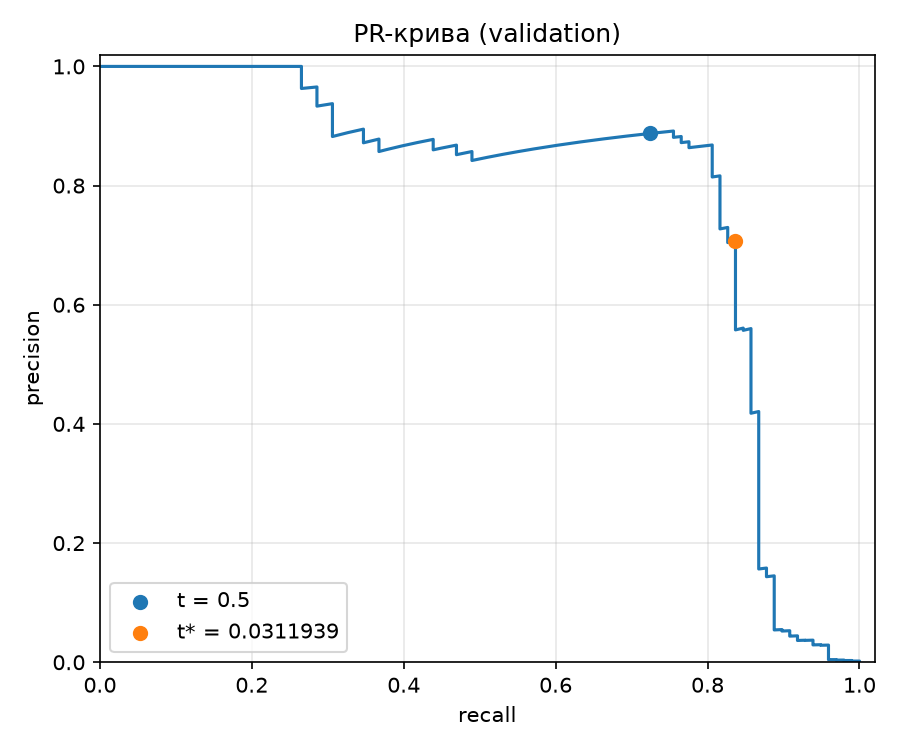
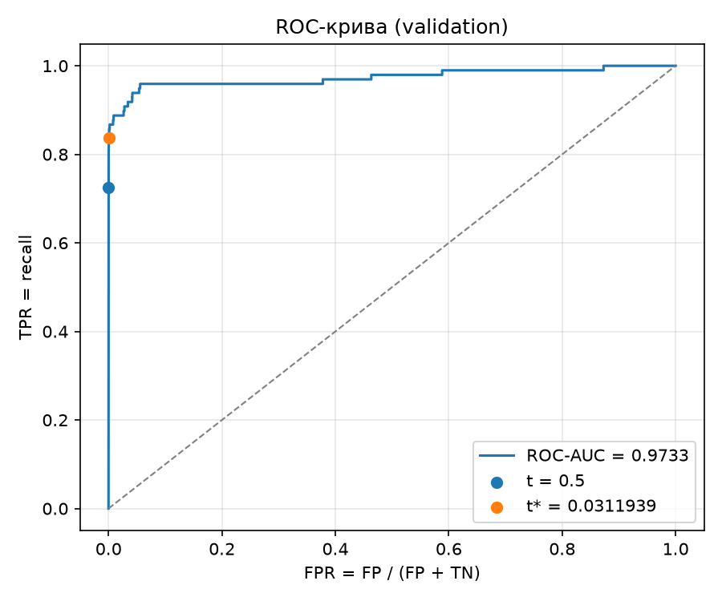

# ЛР2. Поріг рішення під асиметричну ціну помилок

**Виконав:** Швидкий Олександр, студент групи КМ-31
КПІ ім. Ігоря Сікорського, ФПСМ (Факультет програмних систем та прикладної математики)

Модель `Linear(29,32) → ReLU → Linear(32,1)` навчено один раз на Credit Card Fraud Detection. Далі модель не змінюється: на validation обирається поріг рішення, що мінімізує вартість `C = 10·FN + FP`, пошук перевіряється незалежним перебором на трьох малих наборах, і лише після цього поріг застосовується до test.

## 1. Дані та відтворення

Набір: [Credit Card Fraud Detection](https://www.kaggle.com/datasets/mlg-ulb/creditcardfraud) (Kaggle, потрібен обліковий запис), файл `creditcard.csv` — 284 807 транзакцій, 492 шахрайські. До репозиторію файл не додано (`.gitignore`); шлях до локальної копії передається параметром `--data`. Для цього запуску використано копію того самого файлу з публічного дзеркала TensorFlow (`https://storage.googleapis.com/download.tensorflow.org/data/creditcard.csv`, 150 828 752 байти).

Потрібен лише [uv](https://docs.astral.sh/uv/). Версії зафіксовані в `pyproject.toml` (точні `==`) і `uv.lock`, Python — 3.12.

```bash
cd lab2

# 1) навчання з локального CSV (один раз; тека --out має бути порожньою або не існувати)
#    файл треба самостійно покласти в lab2/data/ або передати в --data власний шлях
uv run python lab2_starter.py --data data/creditcard.csv --out retrain

# 2) аналіз порогів (пп. 2–4) зі збережених прогнозів, без CSV і без навчання
uv run python analysis.py --saved results --out analysis
```

Необов'язково: покрокова демонстрація в Jupyter — `uv run --group notebook jupyter lab lab2.ipynb` (ноутбук збережено з виводом; перевиконати без відкриття: `uv run --group notebook jupyter nbconvert --to notebook --execute --inplace lab2.ipynb`). Група `notebook` (jupyterlab, ipykernel, nbconvert, точні версії) окрема: звичайний `uv sync` її не встановлює.

`results/` — збережені ваги й прогнози, на яких побудовано цей звіт. `retrain/` — тека для повторного навчання на машині викладача (у `.gitignore`): стартовий код навмисно відмовляється писати в непорожню теку, тому команда не пише в `results/`. Щоб перевірити відтворення поділу й стандартизації, порівняйте `retrain/split_summary.csv` і `retrain/preprocessing.npz` з відповідними файлами в `results/`. У `results/run.json` поле `source_csv` замінено на `creditcard.csv`, щоб не публікувати локальний шлях; аналіз це поле не читає. Друга команда відтворює всі числа, таблиці й рисунки цього README (таблиці — у `analysis/report.md`).

| Пакет | Версія |
|---|---|
| Python | 3.12 |
| numpy | 2.5.4 |
| pandas | 3.0.6 |
| scikit-learn | 1.9.1 |
| torch | 2.14.1 |
| matplotlib | 3.11.2 |

Повторне навчання на тій самій машині (macOS, arm64) дало побітово ті самі індекси поділу, статистики стандартизації та оцінки. На іншій платформі оцінки можуть відрізнятися в молодших розрядах; висновки нижче зроблено за збереженими прогнозами з `results/`.

### Файли

| Файл | Призначення |
|---|---|
| `lab2_starter.py` | стартовий код викладача без змін: поділ, стандартизація, навчання, збереження прогнозів |
| `thresholds.py` | власний підрахунок TP/FP/FN/TN і `C`; пошук порога через сортування та кумулятивні суми |
| `verification.py` | набори A/B/C і незалежний прямий перебір (чистий Python, не імпортує `thresholds.py`) |
| `analysis.py` | команда аналізу: validation → перевірка A/B/C → test |
| `lab2.ipynb` | покрокова демонстрація (імпортує ті самі модулі, логіку не дублює); збережено з виводом |
| `results/` | `model.pt` (ваги), `predictions.npz` (індекси поділу, мітки, Amount, оцінки без округлення), `preprocessing.npz` (статистики scaler), `run.json`, `split_summary.csv` |
| `analysis/candidates_validation.csv` | повна таблиця кандидатів: `threshold, TP, FP, FN, TN, C` |
| `analysis/threshold.json` | зафіксований поріг `t*` |
| `analysis/pr_curve_validation.png`, `analysis/roc_curve_validation.png` | криві на validation |
| `analysis/verification.json` | результати трьох перевірок |
| `analysis/test_evaluation.json`, `analysis/test_errors.csv`, `analysis/test_error_examples.csv` | тестова оцінка, усі помилки на test і десять розібраних прикладів |
| `analysis/report.md` | усі таблиці цього README в одному файлі |

## 2. Поділ і підготовка даних

Ознаки: `V1`–`V28` і `Amount` (29 штук); `Time` і `Class` на вхід моделі не подаються, сире значення `Amount` збережено окремо. Індекси рядків CSV діляться стратифіковано: спочатку `train_test_split(test_size=0.4, stratify=Class, random_state=0)`, потім відкладена частина — навпіл (`test_size=0.5`, стратифікація за її мітками, `random_state=0`): перша половина — validation, друга — test. Класи не балансуються.

| Вибірка | Об'єктів | Шахрайських | Частка шахрайських |
|---|---|---|---|
| train | 170884 | 295 | 0.001726 |
| validation | 56961 | 98 | 0.001720 |
| test | 56962 | 99 | 0.001738 |

`StandardScaler` навчено лише на train, ті самі середні й відхилення застосовано до validation і test, масиви переведено у `float32`.

**Чому статистики стандартизації не можна обчислювати на всьому наборі.** Середнє й стандартне відхилення — це параметри, оцінені з даних, так само як ваги моделі. Якщо рахувати їх на всіх рядках, у перетворення train потрапляє інформація про validation і test (витік даних): поріг тоді обирається, а якість оцінюється на прикладах, які вже вплинули на підготовку входів. Оцінка на test перестає бути оцінкою на справді нових даних і виходить оптимістично зміщеною. У реальному застосуванні майбутніх транзакцій на момент навчання немає, тож чесна процедура — та, яку можна повторити, маючи лише train.

Навчання: 12 епох, пакет 1024, Adam (`lr = 1e-3`), `BCEWithLogitsLoss` без зважування класів, `torch.manual_seed(0)`, перестановки з `np.random.default_rng(0)`; використано ваги після 12-ї епохи. Оцінки `s = sigmoid(z)` отримано в режимі `eval()` без градієнтів.

## 3. Метрики та вартість

Для порога `t` транзакція вважається шахрайською, якщо `s ≥ t`. Тоді

- `TP` — кількість прикладів із `y = 1` і `s ≥ t`; `FP` — із `y = 0` і `s ≥ t`;
- `FN` — із `y = 1` і `s < t` (пропущене шахрайство); `TN` — із `y = 0` і `s < t`.

$$C(t) = 10\,FN(t) + FP(t), \qquad \text{precision} = \frac{TP}{TP + FP}, \qquad \text{recall} = \frac{TP}{TP + FN}.$$

`Amount` у вартість не входить. Лічильники й `C` реалізовано власноруч у `thresholds.py`; scikit-learn використано лише для кривих і ROC-AUC.

## 4. Вибір порога на validation




ROC-AUC на validation = **0.973318**.

**Чому висока ROC-AUC не гарантує малої вартості чи високої точності.** ROC-AUC — це ймовірність того, що випадкова шахрайська транзакція отримає вищу оцінку, ніж випадкова легітимна. Вона усереднює якість ранжування за всіма порогами й нічого не каже про один конкретний поріг, на якому приймається рішення. Крім того, обидві осі ROC нормовані всередині свого класу (`TPR = TP/(TP+FN)`, `FPR = FP/(FP+TN)`), тому крива не залежить від частки класів, а precision і `C` — залежать: на validation 56 863 легітимні транзакції на 98 шахрайських, тож 1 % хибних тривог — це близько 569 `FP`, у кілька разів більше, ніж усіх шахрайських. Нарешті, AUC однаково зважує помилки обох типів, а у вартості `FN` у десять разів дорожчий. У цій роботі при AUC 0.973 стандартний поріг 0.5 пропускає 27 із 98 шахрайств (`C = 279`), а навіть на оптимальному порозі лишається 16 пропущених і precision 82/116 ≈ 0.71.

### Пошук порога

Кандидати — усі унікальні оцінки validation і `+∞` (55 979 кандидатів). Алгоритм (`thresholds.candidate_table`):

1. Відсортувати оцінки за спаданням — `O(n log n)`.
2. Порахувати кумулятивні суми позитивних і негативних міток уздовж відсортованого масиву — `O(n)`.
3. Знайти останній індекс кожної групи рівних оцінок. Для порога, що дорівнює оцінці групи, `TP` і `FP` — це значення кумулятивних сум у цьому індексі: позитивний прогноз отримують уся група й усі більші оцінки. Рівні оцінки завжди опиняються по один бік порога, тому «розрізати» групу неможливо.
4. Додати рядок `+∞` з `TP = FP = 0` («усі негативні»). Найменша оцінка дає останній рядок — «усі позитивні».
5. `FN = P − TP`, `TN = N − FP`, `C = 10·FN + FP`, де `P` і `N` — кількості позитивних і негативних міток.

Жодного повторного проходу по вибірці для окремого порога немає; загальна складність `O(n log n)`. Серед порогів із мінімальною `C` береться найбільший (`thresholds.best_threshold`): за рівної вартості це рішення з меншою кількістю тривог.

Результат: **t\* = 0.03119393065571785** (мінімум єдиний). Повна таблиця кандидатів — `analysis/candidates_validation.csv`, поріг — `analysis/threshold.json`.

| Правило на validation | Поріг | TP | FP | FN | TN | C |
|---|---|---|---|---|---|---|
| Стандартний поріг | 0.5 | 71 | 9 | 27 | 56854 | 279 |
| Мінімум вартості | 0.0311939 | 82 | 34 | 16 | 56829 | 194 |
| Усі негативні | +∞ | 0 | 0 | 98 | 56863 | 980 |

## 5. Перевірка реалізації пошуку порога

Перевірочний алгоритм (`verification.py`) написано окремо на чистому Python: для кожного кандидата він проходить усю вибірку й рахує лічильники прямим застосуванням правила `s ≥ t`; найкращий поріг шукає власним циклом. Він не імпортує `thresholds.py` і не бачить його результатів. `analysis.py` порівнює обидві таблиці на точну рівність (поріг, `TP`, `FP`, `FN`, `TN`, `C` у кожному рядку та обраний поріг) і в разі будь-якої розбіжності зупиняється до читання test. Усі три перевірки пройдені.

### Набір A

`s = [0.9, 0.7, 0.7, 0.4, 0.2, 0.1]`, `y = [0, 1, 0, 1, 0, 0]`

| Поріг | TP перебір | FP перебір | FN перебір | TN перебір | C перебір | TP кум. суми | FP кум. суми | FN кум. суми | TN кум. суми | C кум. суми | Збіг |
|---|---|---|---|---|---|---|---|---|---|---|---|
| +∞ | 0 | 0 | 2 | 4 | 20 | 0 | 0 | 2 | 4 | 20 | так |
| 0.9 | 0 | 1 | 2 | 3 | 21 | 0 | 1 | 2 | 3 | 21 | так |
| 0.7 | 1 | 2 | 1 | 2 | 12 | 1 | 2 | 1 | 2 | 12 | так |
| 0.4 | 2 | 2 | 0 | 2 | 2 | 2 | 2 | 0 | 2 | 2 | так |
| 0.2 | 2 | 3 | 0 | 1 | 3 | 2 | 3 | 0 | 1 | 3 | так |
| 0.1 | 2 | 4 | 0 | 0 | 4 | 2 | 4 | 0 | 0 | 4 | так |

t* (перебір) = 0.4; t* (кумулятивні суми) = 0.4; перевірка пройдена

**Що перевіряє.** Дві оцінки 0.7 мають різні мітки. Вони мусять дати одного кандидата й однаковий прогноз: при `t = 0.7` одразу `TP = 1, FP = 2`. Реалізація, яка зчитує кумулятивні суми після кожного елемента, а не в кінці групи, створила б неіснуючий стан `TP = 1, FP = 1` (`C = 11`), якого жоден поріг досягти не може.

### Набір B

`s = [0.9, 0.6, 0.3]`, `y = [0, 0, 0]`

| Поріг | TP перебір | FP перебір | FN перебір | TN перебір | C перебір | TP кум. суми | FP кум. суми | FN кум. суми | TN кум. суми | C кум. суми | Збіг |
|---|---|---|---|---|---|---|---|---|---|---|---|
| +∞ | 0 | 0 | 0 | 3 | 0 | 0 | 0 | 0 | 3 | 0 | так |
| 0.9 | 0 | 1 | 0 | 2 | 1 | 0 | 1 | 0 | 2 | 1 | так |
| 0.6 | 0 | 2 | 0 | 1 | 2 | 0 | 2 | 0 | 1 | 2 | так |
| 0.3 | 0 | 3 | 0 | 0 | 3 | 0 | 3 | 0 | 0 | 3 | так |

t* (перебір) = +∞; t* (кумулятивні суми) = +∞; перевірка пройдена

**Що перевіряє.** Позитивних міток немає, тому `FN = 0` за будь-якого порога й `C = FP`. Єдиний оптимум — граничний кандидат `+∞` («усі негативні», `C = 0`), якого немає серед оцінок: без явного рядка `+∞` пошук повернув би 0.9 з `C = 1`. Також видно, що алгоритм не ділить на кількість позитивних і працює при `P = 0` (recall тут не визначена).

### Набір C

`s = [0.8, 0.5 ×11, 0.2]`, `y = [1, 1, 0 ×10, 0]`

| Поріг | TP перебір | FP перебір | FN перебір | TN перебір | C перебір | TP кум. суми | FP кум. суми | FN кум. суми | TN кум. суми | C кум. суми | Збіг |
|---|---|---|---|---|---|---|---|---|---|---|---|
| +∞ | 0 | 0 | 2 | 11 | 20 | 0 | 0 | 2 | 11 | 20 | так |
| 0.8 | 1 | 0 | 1 | 11 | 10 | 1 | 0 | 1 | 11 | 10 | так |
| 0.5 | 2 | 10 | 0 | 1 | 10 | 2 | 10 | 0 | 1 | 10 | так |
| 0.2 | 2 | 11 | 0 | 0 | 11 | 2 | 11 | 0 | 0 | 11 | так |

t* (перебір) = 0.8; t* (кумулятивні суми) = 0.8; перевірка пройдена

**Що перевіряє.** Пороги 0.8 і 0.5 мають однакову вартість `C = 10`: один пропущений позитивний коштує стільки ж, скільки десять хибних тривог. Правило розв'язання нічиєї має обрати більший поріг 0.8; реалізація, що бере перший мінімум при перегляді порогів за зростанням, повернула б 0.5. Одинадцять рівних оцінок 0.5 додатково перевіряють, що велика група з різними мітками обробляється як один кандидат.

## 6. Тестова оцінка

Поріг `t*` зафіксовано на validation; test не використовувався ні для вибору порога, ні для моделі чи налаштувань.

| Поріг | TP | FP | FN | TN | C | precision | recall |
|---|---|---|---|---|---|---|---|
| 0.0311939 | 80 | 43 | 19 | 56820 | 233 | 0.650407 | 0.808081 |

|  | Прогноз 1 | Прогноз 0 |
|---|---|---|
| Мітка 1 | TP = 80 | FN = 19 |
| Мітка 0 | FP = 43 | TN = 56820 |

Довідково, для висновків (не використовується для вибору порога):

| Поріг на test | TP | FP | FN | TN | C |
|---|---|---|---|---|---|
| 0.5 | 71 | 8 | 28 | 56855 | 288 |
| 0.0311939 | 80 | 43 | 19 | 56820 | 233 |
| +∞ | 0 | 0 | 99 | 56863 | 990 |

**Нульовий знаменник.** Якщо `TP + FP = 0`, модель не зробила жодного позитивного прогнозу (наприклад, при `t = +∞`), і precision — це частка правильних серед нуля тривог, тобто `0/0`: оцінювати нічого. Якщо `TP + FN = 0`, у вибірці немає жодного шахрайства (як у наборі B), і recall — частка знайдених серед нуля наявних, знову `0/0`. Підставляти 0 чи 1 було б довільною домовленістю, а не виміром, тому код повертає «не визначена». На test обидва знаменники ненульові (123 і 99).

### Приклади помилок

Перші п'ять FP і перші п'ять FN за номером рядка CSV (усі 62 помилки — в `analysis/test_errors.csv`):

| Рядок CSV (від 0, без заголовка) | Тип помилки | Мітка | Оцінка s | Amount | s − t* |
|---|---|---|---|---|---|
| 460 | FP | 0 | 0.196159 | 2.00 | +0.164965 |
| 2961 | FP | 0 | 0.0809608 | 2.49 | +0.0497669 |
| 10783 | FP | 0 | 0.966327 | 89.99 | +0.935133 |
| 13405 | FP | 0 | 0.932032 | 89.99 | +0.900838 |
| 13617 | FP | 0 | 0.922762 | 89.99 | +0.891568 |
| 10497 | FN | 1 | 0.0114643 | 3.79 | -0.0197296 |
| 52521 | FN | 1 | 0.00637309 | 105.99 | -0.0248208 |
| 55401 | FN | 1 | 0.00564157 | 1.00 | -0.0255524 |
| 91671 | FN | 1 | 0.000500423 | 290.18 | -0.0306935 |
| 93486 | FN | 1 | 0.0183515 | 0.00 | -0.0128424 |

Зведення за всіма помилками на test:

| Тип | Кількість | Amount: медіана | Amount: середнє | Amount: min – max | abs(s − t*): медіана | abs(s − t*): min | abs(s − t*): max |
|---|---|---|---|---|---|---|---|
| FP | 43 | 2.49 | 110.98 | 0.00 – 1000.00 | 0.02499 | 0.000191819 | 0.935133 |
| FN | 19 | 33.76 | 161.99 | 0.00 – 829.41 | 0.0291183 | 0.00970319 | 0.0311448 |

**Amount.** У десяти прикладах суми в обох групах змішані: FP — 2.00, 2.49 і тричі 89.99; FN — від 0.00 до 290.18. За всіма помилками медіана Amount у FN більша (33.76 проти 2.49), але діапазони майже повністю перекриваються (0–1000 і 0–829), а середні близькі за порядком. Чіткої межі за сумою, яка відділяла б один тип помилок від іншого, не видно.

**Відстань від порога.** Тут групи відрізняються суттєво, але частково через геометрію: `t*` лежить біля нуля, тому FN не може бути далі від порога, ніж сам `t* ≈ 0.0312`, а FP може бути віддаленим майже на 1. Важливіше, де помилки розташовані в межах свого діапазону. Медіанний FN віддалений на 0.0291, тобто має оцінку близько 0.002: більшість пропущених шахрайств модель вважає майже напевно легітимними, і розумним зсувом порога їх не повернути — це помилки ранжування, а не порога. FP двох видів: 8 із 43 мають `s ≥ 0.5` (серед них три приклади з таблиці з оцінками понад 0.92) і лишаються хибними тривогами за будь-якого розумного порога; решта 35 з'явилися саме через зниження порога, і половина всіх FP лежить ближче ніж 0.025 до `t*`.

**Чи можна за десятьма прикладами судити про причину помилок?** Ні. Приклади відібрано за номером рядка, а не випадково; їх п'ять із 43 FP і п'ять із 19 FN. Три FP із сумою 89.99 поспіль виглядають як закономірність, але це може бути збіг або одна серія транзакцій. Ознаки `V1`–`V28` — анонімізовані головні компоненти, тому змістовно пояснити окрему помилку неможливо, а `Amount` — лише одна з 29 ознак. Десять прикладів годяться, щоб сформулювати гіпотезу; для перевірки потрібні всі помилки, порівняння з розподілами правильно класифікованих прикладів і окремі досліди.

## 7. Висновки

**Що змінив вибір порога.** Модель, її ваги й оцінки лишилися тими самими; змінилася лише межа, за якою оцінка перетворюється на рішення. Зниження порога з 0.5 до `t* ≈ 0.0312` перевело частину транзакцій із низькими, але не нульовими оцінками в позитивні. На validation вартість упала з 279 до 194 (−85), на test — з 288 до 233 (−55). Порівняно з правилом «усі негативні» (`C = 980` і `990`) обидва пороги набагато кращі.

**Ціна рішення.** Це обмін хибних тривог на знайдені шахрайства. На validation: `FN` 27 → 16 (−11, економія 110), `FP` 9 → 34 (+25). На test: `FN` 28 → 19 (−9, економія 90), `FP` 8 → 43 (+35). Precision на test при цьому знизилася з 71/79 ≈ 0.90 до 80/123 ≈ 0.65: приблизно кожна третя тривога тепер хибна. Обмін вигідний лише тому, що пропущене шахрайство за умовою коштує вдесятеро більше за хибну тривогу; за іншого співвідношення цін оптимальний поріг був би іншим.

**Чому validation не гарантує такого самого виграшу на test.** Поріг `t*` — це параметр, підібраний під конкретні 56 961 приклад: серед 55 979 кандидатів узято той, що найкраще ліг саме на цю вибірку, тож мінімум `C` на validation оптимістично зміщений. Крім того, вартість визначається кількома десятками рідкісних подій (98 шахрайств на validation, 99 на test), і зміна долі одного-двох прикладів зсуває `C` на 10–20. Це видно в результатах: на test той самий поріг дав на 9 `FP` більше й на 3 `FN` більше, ніж на validation, і виграш відносно 0.5 зменшився з 85 до 55. Напрям ефекту зберігся, але його розмір — оцінка з помітною дисперсією, а на нових даних із іншим розподілом транзакцій він може бути ще іншим.

## Використані інструменти

Стартовий код (`lab2_starter.py`) надано викладачем. Під час виконання роботи використано генеративний ШІ-інструмент Claude Code (Anthropic): код аналізу, перевірок і текст звіту підготовлено з його допомогою; результати перевірено запуском наведених команд.
