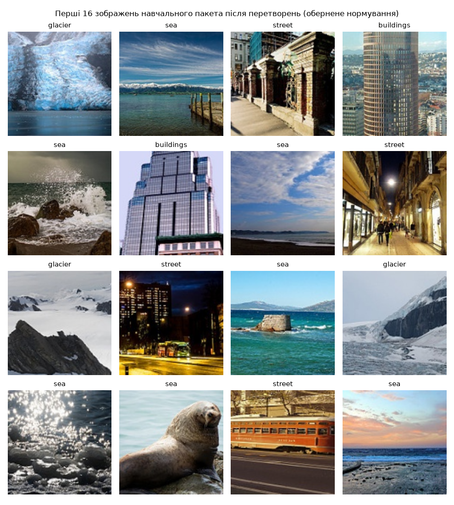
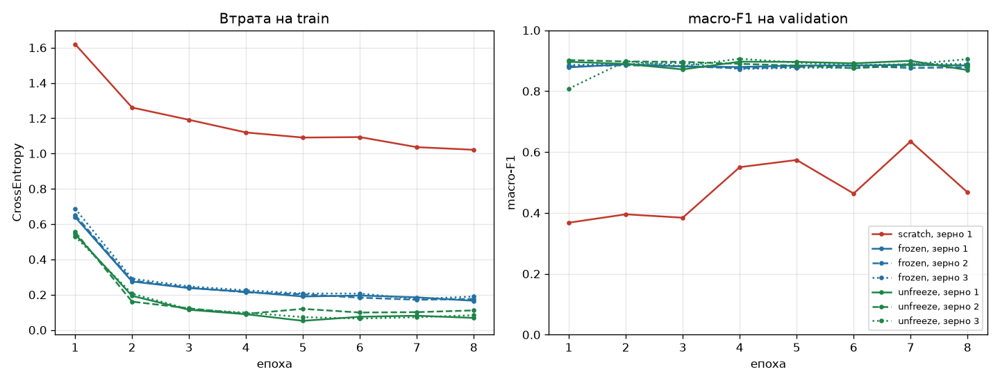
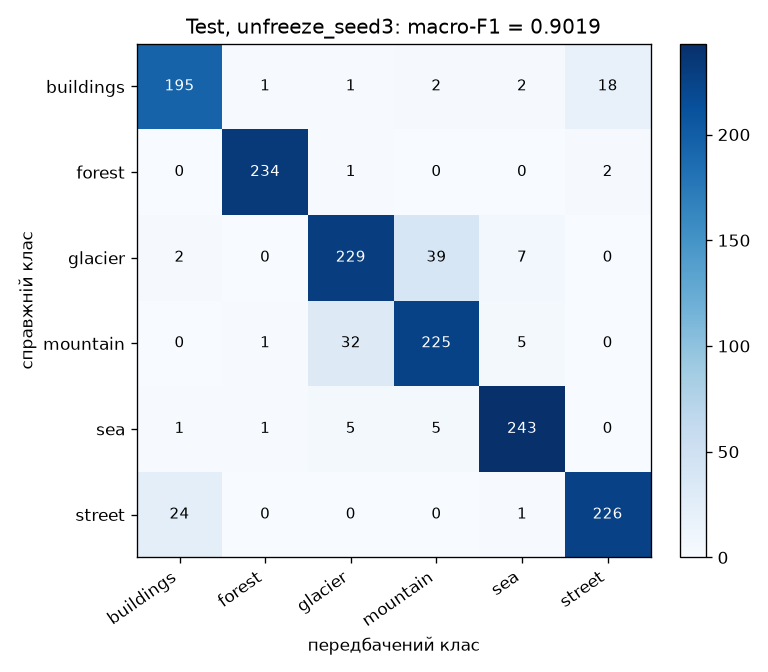
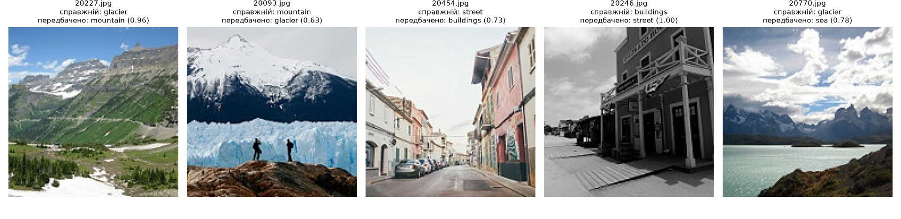

# ЛР3. Обчислювальний експеримент і трансферне навчання

**Виконав:** Швидкий Олександр, студент групи КМ-31
КПІ ім. Ігоря Сікорського, ФПСМ (Факультет програмних систем та прикладної математики)

ResNet-18 навчено на 200 зображеннях на клас (Intel Image Classification, 6 класів) у трьох режимах за однакового бюджету в 304 кроки оптимізатора: з нуля (`scratch`), з замороженим ImageNet-кістяком (`frozen`) і з розмороженим `layer4` (`unfreeze`). Режими порівнюються за macro-F1 на validation з урахуванням розкиду між зернами; вибрана модель один раз оцінюється на test.

**Коротко:** попередньо навчені ознаки дають +41.6 п. macro-F1 (у 11.6 раза більше за розкид R = 3.6 п.); розморожування `layer4` дає +0.3 п., що не відрізняється від розкиду. Вибрана модель (`unfreeze`, зерно 3) має macro-F1 0.9019 на test.

## 1. Дані та відтворення

Набір: [Intel Image Classification](https://www.kaggle.com/datasets/puneet6060/intel-image-classification) (Kaggle). Використано `seg_train/seg_train` (14 034 зображення) і `seg_test/seg_test` (3 000); `seg_pred` не використовується. До репозиторію набір не додано (`data/` у `.gitignore`). Архів завантажено анонімно через `https://www.kaggle.com/api/v1/datasets/download/puneet6060/intel-image-classification` (363 152 213 байт) і розпаковано в `lab3/data/`.

Потрібен лише [uv](https://docs.astral.sh/uv/). Версії зафіксовано в `pyproject.toml` (точні `==`) і `uv.lock`, Python 3.12.

```bash
cd lab3

# 1) навчання: поділ → split.csv, перевірки пп. 1–2, сім запусків, журнали, вибір → lab3_model.pt (test не використовується)
uv run python train.py --data data            # data/ містить seg_train/ і seg_test/

#    щоб не перезаписати збережені результати, можна писати в окрему теку:
uv run python train.py --data data --out retrain

# 2) аналіз: перевірка хешу split.csv у журналах, таблиця, криві, ефекти, перевірка вибору,
#    потім одноразова тестова оцінка lab3_model.pt на CPU, матриця плутанини, п'ять помилок
uv run python analyze.py --data data
```

Друга команда за збереженими `runs/` і `lab3_model.pt` відтворює всі числа пп. 3–5 цього README (вони взяті з її виводу, копія — `analysis/report.md`). Навчання на машині виконання (Apple M1 Pro, MPS) займає близько 5 хвилин разом із перевірками. Повторне навчання на тій самій машині дало побітово ті самі `split.csv`, логіти validation і ваги всіх семи запусків (відрізнявся лише час); на іншому пристрої чи версіях бібліотек macro-F1 може відрізнятися.

| Пакет | Версія |
|---|---|
| Python | 3.12.13 |
| torch | 2.14.1 |
| torchvision | 0.29.1 |
| numpy | 2.5.4 |
| scikit-learn | 1.9.1 |
| matplotlib | 3.11.2 |
| pillow | 13.0.0 |

Навчання — на `mps` (Apple M1 Pro), `float32`; тестова оцінка — на CPU.

### Файли

| Файл | Призначення |
|---|---|
| `common.py` | поділ, датасет, перетворення, побудова моделі за кроками 1–5, `set_train_mode`, епоха навчання, macro-F1. Test тут не завантажується (`part_rows` відмовляє для `test`) |
| `train.py` | команда навчання (пп. 1–3, 5 — вибір); `--checks-only` — лише поділ і перевірки |
| `analyze.py` | команда аналізу (пп. 3–5); єдиний модуль, що читає test |
| `split.csv` | поділ: `file, label, part` (train → validation → test, у межах частини — за класами) |
| `checks/report.md`, `checks/checks.json` | результати перевірок пп. 1–2, прогноз і результат досліду з BN |
| `runs/<режим>_seed<зерно>/run.json`, `val_logits.npy` | журнали й логіти validation (1498 × 6) семи запусків. Ваги запусків (`model.pt`) лишаються локально (`.gitignore`) |
| `runs/selection.json` | результат вибору за validation |
| `lab3_model.pt` | ваги вибраного запуску: `state_dict, regime, seed, classes, img_size` (43 МБ) |
| `analysis/report.md`, `analysis/results.json` | вивід команди аналізу |
| `analysis/test_logits.npy`, `analysis/test_predictions.csv` | логіти й передбачення вибраної моделі на test |
| `figures/train_batch.png`, `curves.png`, `confusion_test.png`, `test_errors.png` | рисунки |

### Журнал запуску

`run.json` містить: зерно й режим; усі налаштування перетворень (зчитані з самих об'єктів torchvision, разом зі значеннями за замовчуванням: `ratio=(3/4, 4/3)`, `interpolation=bilinear`, `antialias=True`, `p=0.5`), моделі (ваги, модулі, що навчаються і що в `eval()`, кількості параметрів, `momentum`/`eps` BN), оптимізатора (`AdamW`, групи з `lr`, `weight_decay`, `betas`, `eps`, `amsgrad` та всі `defaults`), втрати, завантажувачів, бюджету (8 × 38 = 304 кроки, останній пакет 16) і перелік того, що не використовується; коміт і позначку незакомічених змін; SHA-256 `split.csv`; версії Python, PyTorch, torchvision, NumPy, платформу й пристрій; втрату train і macro-F1 validation за кожну епоху; час навчання (лише епохи навчання) і час навчання з оцінкою validation; SHA-256 вмісту фінального `state_dict` (за ним аналіз перевіряє, що `lab3_model.pt` — ваги саме вибраного запуску).

**Коміт.** Усі сім запусків виконано з коміту `580bd07` («ЛР3: код навчання й аналізу») без незакомічених змін у коді (`uncommitted_changes_in_lab3: false` у всіх журналах). Результати додано наступним комітом. Додатково в журнал записано SHA-256 файлів, від яких залежить навчання (`common.py`, `train.py`); у всіх семи журналах вони однакові.

**Відхилення від фіксованих налаштувань:** немає. Технічні деталі, що не змінюють протоколу: декодовані зображення train/validation/test тримаються в пам'яті (випадкові перетворення застосовуються при кожному зверненні, тому споживання генератора PyTorch від цього не залежить); версію Pillow (13.0.0) завдання не фіксує.

## 2. Перевірки до навчання (п. 1)

### Поділ

Поділ побудовано за процедурою завдання (імена відсортовано як рядки; один `default_rng(0)` на всі класи train, новий `default_rng(0)` на всі класи seg_test). Кожна клітинка — «кількість / сума числових імен».

| Клас | train | validation | test |
|---|---|---|---|
| buildings | 200 / 1 996 761 ✓ | 218 / 4 837 323 ✓ | 219 / 4 837 559 ✓ |
| forest | 200 / 2 032 625 ✓ | 237 / 5 276 962 ✓ | 237 / 5 291 326 ✓ |
| glacier | 200 / 2 183 923 ✓ | 276 / 6 135 652 ✓ | 277 / 6 157 250 ✓ |
| mountain | 200 / 1 950 345 ✓ | 262 / 5 789 535 ✓ | 263 / 5 849 765 ✓ |
| sea | 200 / 1 987 613 ✓ | 255 / 5 655 068 ✓ | 255 / 5 668 011 ✓ |
| street | 200 / 1 841 817 ✓ | 250 / 5 541 845 ✓ | 251 / 5 547 533 ✓ |
| **Разом** | 1200 / 11 993 084 | 1498 / 33 236 385 | 1502 / 33 351 444 |

Усі 18 клітинок збігаються з контрольною таблицею. Перетини частин: train∩validation = train∩test = validation∩test = 0 файлів; усі 4200 імен у `split.csv` унікальні. SHA-256 `split.csv`: `148dad92de9a18670c177df9f8757aa6519fb0ea6d74a8ba723cfc4453f0a1bc`.

### Пакет після перетворень



Перші 16 зображень навчального пакета після `RandomResizedCrop(160, scale=(0.7, 1.0))` і `RandomHorizontalFlip()`, з оберненим нормуванням (`x·std + mean`) і міткою над кожним. Кольори природні, отже нормування й обернене нормування узгоджені; мітки відповідають змісту.

### Початкова втрата L0

Модель за кроками 1–5 (зерно 1), `set_train_mode`, перший пакет навчального завантажувача, `torch.no_grad()`, без кроків оптимізатора.

| Режим | L0 | L0 − ln 6 | std логітів | max \|логіт\| |
|---|---|---|---|---|
| scratch | 2.0479 | +0.2561 | 0.488 | 1.483 |
| frozen | 1.9244 | +0.1326 | 0.614 | 1.713 |

ln 6 ≈ 1.7918. Обидва значення трохи більші за ln 6, і це очікувано. ln 6 — втрата моделі, у якої всі логіти однакові. Нова голова `Linear(512, 6)` ініціалізується випадково (`U(−1/√512, 1/√512)` для ваг і зсуву), тому логіти не нульові: їхнє std ≈ 0.5–0.6. Будь-яке відхилення логітів від рівних, не пов'язане з правильним класом, у середньому збільшує крос-ентропію: L0 = ln 6 + (втрата від випадкових «переконань»), і для малих логітів надлишок приблизно пропорційний їхній дисперсії. У `scratch` ознаки випадкової мережі для різних зображень дуже схожі, тож голова має майже однакову «упередженість» до одного класу для всього пакета: відхилення систематичне і не усереднюється. Через це L0 у `scratch` більша, хоча std логітів менше. У `frozen` ознаки ImageNet за величиною більші (std логітів 0.61), але різні для різних зображень. Надлишок у 0.13–0.26 нат малий і означає, що ініціалізація нормальна. L0 ≫ ln 6 (наприклад, 5–10) означало б помилку в нормуванні чи голові.

## 3. Перевірка режимів навчання (п. 2)

Кожна перевірка — новий екземпляр моделі за кроками 1–5 зі зерном 1; ці моделі не оцінюються на validation і не зберігаються.

### Параметри

Кількість параметрів — сума `numel()`.

| Режим | Усього параметрів | requires_grad=True | Групи AdamW (параметрів @ lr) | Параметрів із requires_grad=False в оптимізаторі | Збігається |
|---|---|---|---|---|---|
| scratch | 11 179 590 | 11 179 590 | уся мережа: 11 179 590 @ lr=0.003 | 0 | так |
| frozen | 11 179 590 | 3 078 | fc: 3 078 @ lr=0.003 | 0 | так |
| unfreeze | 11 179 590 | 8 396 806 | fc: 3 078 @ lr=0.003; layer4: 8 393 728 @ lr=0.0003 | 0 | так |

`weight_decay = 1e-4` у всіх групах. Додатково перевірено, що кожен параметр із `requires_grad=True` є в оптимізаторі.

### Що змінюється під час навчання

Копія повного `state_dict()` (параметри й буфери) → `set_train_mode` → 5 кроків на перших 5 пакетах → порівняння `torch.equal` для кожного модуля верхнього рівня.

| Режим | Модуль | Параметри змінилися | Ковзні статистики BN змінилися | Збігається з очікуваним |
|---|---|---|---|---|
| frozen | conv1 | ні | немає BN | так |
| frozen | bn1 | ні | ні | так |
| frozen | layer1 | ні | ні | так |
| frozen | layer2 | ні | ні | так |
| frozen | layer3 | ні | ні | так |
| frozen | layer4 | ні | ні | так |
| frozen | fc | так | немає BN | так |
| unfreeze | conv1 | ні | немає BN | так |
| unfreeze | bn1 | ні | ні | так |
| unfreeze | layer1 | ні | ні | так |
| unfreeze | layer2 | ні | ні | так |
| unfreeze | layer3 | ні | ні | так |
| unfreeze | layer4 | так | так | так |
| unfreeze | fc | так | немає BN | так |

Усі 14 рядків збігаються з очікуваним: модулі зі стовпця «У `eval()`» не змінили ні параметрів, ні ковзних статистик; решта змінили параметри, а `layer4` у `unfreeze` — ще й статистики BN.

### Дослід із навмисною помилкою: `frozen` з `model.train()` замість `set_train_mode`

**Прогноз (записано до запуску; `train.py` пише його в `checks/report.md` перед виконанням досліду).** Параметри замороженого кістяка (conv1, bn1, layer1–layer4) не зміняться: вони мають `requires_grad=False`, градієнтів не отримують і в оптимізатор не передані. Зміняться ковзні статистики BN (`running_mean`, `running_var`, `num_batches_tracked`) у `bn1` і в усіх BN шарів `layer1`–`layer4`: у режимі `train()` BN на кожному прямому проході оновлює їх за статистиками пакета незалежно від `requires_grad`. У `conv1` BN немає; `fc` змінить параметри, як і в правильному варіанті. З кривої втрати на train цього майже не видно: втрата далі спадає, бо в `train()` BN нормує за статистиками пакета й голова бачить узгоджені ознаки. Помилка проявиться лише в `eval()`: там використовуються ковзні статистики, які вже не ImageNet-івські й залежать від історії пакетів, тобто ознаки на validation/test відрізняються від тих, на яких навчалась голова, а «заморожений» кістяк насправді змінюється.

**Результат:**

| Модуль | Параметри змінилися | Ковзні статистики BN змінилися | Збігається з прогнозом |
|---|---|---|---|
| conv1 | ні | немає BN | так |
| bn1 | ні | так | так |
| layer1 | ні | так | так |
| layer2 | ні | так | так |
| layer3 | ні | так | так |
| layer4 | ні | так | так |
| fc | так | немає BN | так |

| Величина | set_train_mode (правильно) | model.train() (помилка) |
|---|---|---|
| max \|Δ running_mean\| у layer1.0.bn1 | 0 | 0.0928 |
| max \|Δ running_var\| у layer1.0.bn1 | 0 | 0.1203 |
| втрата на 5 кроках | 1.924, 1.765, 1.614, 1.387, 1.289 | 1.887, 1.946, 1.844, 1.684, 1.407 |

Результат збігається з прогнозом. Втрата в обох варіантах спадає, а на першому кроці (однакові ваги) відрізняється лише через різне нормування (1.924 проти 1.887). За кривою втрати train помилку не розпізнати: вона виглядає як звичайний шум зерна. Її видно лише при прямому порівнянні буферів.

**Чому `requires_grad=False` не захищає ці значення.** `requires_grad` керує лише автоградієнтом: чи рахувати градієнт за тензором і, отже, чи зможе оптимізатор його змінити. `running_mean` і `running_var` — не параметри, а буфери. Їх оновлює сам шар BN у прямому проході в режимі `train()` (`running = (1 − 0.1)·running + 0.1·batch_stat`) без участі градієнтів і оптимізатора. Від оновлення захищає лише режим `eval()`, тому заморожені модулі треба явно перевести в `eval()` після `model.train()`.

**Чому для `layer4` у `unfreeze` оновлення правильне.** Ваги `layer4` навчаються на новій задачі, отже змінюється розподіл активацій на входах його BN. Під час навчання BN нормує за статистиками пакета, і щоб у `eval()` модель поводилася так само, ковзні статистики мають відстежувати саме ці нові розподіли. Якби `layer4` був у `eval()`, він нормував би ознаки, що змінюються, за застарілими статистиками ImageNet. Для замороженого ж кістяка ваги не змінюються, і правильні статистики — саме ті, з якими його навчено.

## 4. Сім запусків (п. 3)

| # | Режим | Зерно | Втрата train, епоха 8 | macro-F1 validation, епоха 8 | Час навчання, с |
|---|---|---|---|---|---|
| 1 | scratch | 1 | 1.0212 | 0.4675 | 37.7 |
| 2 | frozen | 1 | 0.1655 | 0.8842 | 14.8 |
| 3 | frozen | 2 | 0.1757 | 0.8785 | 14.5 |
| 4 | frozen | 3 | 0.1896 | 0.8886 | 14.7 |
| 5 | unfreeze | 1 | 0.0685 | 0.8692 | 19.7 |
| 6 | unfreeze | 2 | 0.1111 | 0.8855 | 19.8 |
| 7 | unfreeze | 3 | 0.0838 | 0.9050 | 21.2 |

Час навчання — сума часу 8 епох навчання (без оцінки validation), Apple M1 Pro, MPS. `frozen` дає ≈ 0.88, як і в орієнтирі завдання; `scratch` помітно нижче, але далеко від вгадування (1/6 ≈ 0.17).



## 5. Розклад ефектів (п. 4)

$$\bar F_r = \frac13\sum_{s=1}^{3} F_{r,s},\quad R_r = \max_s F_{r,s} - \min_s F_{r,s},\quad R = \max(R_{\text{frozen}}, R_{\text{unfreeze}}),$$
$$\Delta_{\text{pre}} = \bar F_{\text{frozen}} - F_{\text{scratch},1},\qquad \Delta_{\text{unf}} = \bar F_{\text{unfreeze}} - \bar F_{\text{frozen}},\qquad \Delta_{\text{pre}} + \Delta_{\text{unf}} = \bar F_{\text{unfreeze}} - F_{\text{scratch},1}.$$

F_{r,s} по зернах 1, 2, 3: frozen — 0.8842, 0.8785, 0.8886; unfreeze — 0.8692, 0.8855, 0.9050.

| Величина | Значення |
|---|---|
| F̄_frozen, R_frozen | 0.8838, 0.0101 |
| F̄_unfreeze, R_unfreeze | 0.8866, 0.0358 |
| F_scratch,1 | 0.4675 |
| R | 0.0358 |
| Δ_pre | +0.4163 (+41.63 п.; \|Δ\|/R = 11.6) — вартий перевірки (\|Δ\| > R) |
| Δ_unf | +0.0028 (+0.28 п.; \|Δ\|/R = 0.1) — не відрізняється від розкиду (\|Δ\| ≤ R) |
| Δ_pre + Δ_unf | +0.4191 (+41.91 п.) |

**Інтерпретація.** Δ_pre у 11.6 раза перевищує поріг шуму, тобто ефект попереднього навчання вартий перевірки (за правилом — не доведений, але дуже великий). Δ_unf = +0.28 п. становить менше десятої частини R: **ефекту розморожування за цих даних немає**, різниця не відрізняється від розкиду.

**Що змінює зерно в кожному режимі.** Зерно засіює глобальний генератор PyTorch на кроці 1, тому від нього залежать: (а) випадкова ініціалізація — уся мережа в `scratch`, лише голова `fc` у `frozen` і `unfreeze` (ваги ImageNet фіксовані й від зерна не залежать); (б) порядок пакетів (`shuffle=True`); (в) аугментації (`RandomResizedCrop`, `RandomHorizontalFlip`). Розкид у `frozen` малий (R = 1.0 п.): кістяк фіксований, і задача зводиться до навчання лінійного класифікатора (опукла задача) на майже детермінованих ознаках. Зерно впливає лише на шлях до оптимуму й на аугментовані версії тих самих 1200 зображень. У `unfreeze` навчаються ще 8.4 млн параметрів `layer4`. Траєкторія в невипуклому просторі залежить від порядку пакетів і аугментацій, модель майже запам'ятовує train (втрата 0.07–0.11 проти 0.17–0.19 у `frozen`), і в такому режимі передбачення на validation залежать від випадкових деталей навчання. Тому R_unfreeze = 3.6 п. утричі більший. Через це поріг R визначає саме `unfreeze`.

**Чому R не характеризує розкид запуску 1.** R виміряно на запусках 2–7, тобто на моделях із фіксованим ImageNet-кістяком, де зерно змінює лише голову, порядок і аугментації. У `scratch` зерно змінює ініціалізацію всіх 11.2 млн параметрів, і навчання за 304 кроки далеке від збіжності. Крива запуску 1 це показує: macro-F1 на validation від епохи до епохи стрибає 0.37 → 0.40 → 0.38 → 0.55 → 0.57 → 0.46 → 0.63 → 0.47. Лише між епохами 7 і 8 він упав на 16.8 п., що в 4.7 раза більше за R. Отже, `F_scratch,1` — одне значення з дуже шумного розподілу, і справжній розкид `scratch` за зернами, імовірно, порядку десятків пунктів. Висновок про **напрям** Δ_pre від цього не змінюється: навіть найкраща епоха запуску 1 (0.635) на 24.4 п. нижча за найгірший запуск `frozen` (0.8785). Але **величину** Δ_pre (41.6 п.) треба читати як грубу. Вона значною мірою залежить від того, на яку фазу коливань припала 8-ма епоха, а з одним запуском `scratch` поріг шуму для нього оцінити неможливо.

**Чи однаковий бюджет за часом.** Ні. Однакова лише кількість кроків оптимізатора (304) і переглядів даних (8 епох). Середній час навчання: `scratch` — 37.7 с, `unfreeze` — 20.2 с, `frozen` — 14.7 с (MPS, M1 Pro). `frozen` не рахує зворотний прохід через кістяк і не оновлює його ваги. `unfreeze` поширює градієнт лише через `layer4`. `scratch` рахує градієнти й кроки AdamW для всіх 11.2 млн параметрів. За однакового часу `scratch` встиг би приблизно 2.5 раза менше кроків, ніж `frozen`. Тобто протокол за кроками для `scratch` навіть вигідніший, ніж протокол за часом.

## 6. Вибір конфігурації і тестова оцінка (п. 5)

**Вибір лише за validation** (у `train.py`): F̄_scratch = 0.4675, F̄_frozen = 0.8838, F̄_unfreeze = 0.8866, отже режим — **unfreeze**. Серед його запусків найбільший F_{r,s} має зерно 3 (0.9050), тож `lab3_model.pt` — ваги запуску **unfreeze_seed3** (`regime="unfreeze"`, `seed=3`, `classes` у фіксованому порядку, `img_size=160`).

**Цей вибір визначив шум:** |Δ_unf| = 0.0028 ≤ R = 0.0358. Перевага `unfreeze` над `frozen` за середнім (0.28 п.) — менше десятої частини розкиду, і за інших зерен вибір міг би впасти на `frozen`. Процедуру не змінено.

Команда аналізу перевіряє, що `lab3_model.pt` відповідає правилу вибору за журналами: режим, зерно, класи, `img_size` і SHA-256 вмісту `state_dict` збігаються з журналом `unfreeze_seed3`. Лише після цього вона один раз обчислює логіти test на CPU.

| Величина | Значення |
|---|---|
| macro-F1 test | **0.9019** |
| accuracy test (p) | 0.9001 |
| n | 1502 |
| SE = √(p(1−p)/n) | 0.0077 (0.77 п.) |
| F вибраного запуску на validation | 0.9050 |
| test − validation | −0.0031 (−0.31 п.) |

### Матриця плутанини test

Рядки — справжній клас, стовпці — передбачений.

|  | buildings | forest | glacier | mountain | sea | street | усього |
|---|---|---|---|---|---|---|---|
| **buildings** | 195 | 1 | 1 | 2 | 2 | 18 | 219 |
| **forest** | 0 | 234 | 1 | 0 | 0 | 2 | 237 |
| **glacier** | 2 | 0 | 229 | 39 | 7 | 0 | 277 |
| **mountain** | 0 | 1 | 32 | 225 | 5 | 0 | 263 |
| **sea** | 1 | 1 | 5 | 5 | 243 | 0 | 255 |
| **street** | 24 | 0 | 0 | 0 | 1 | 226 | 251 |



Помилки зосереджені у двох парах: glacier ↔ mountain (39 + 32 = 71 із 150 помилок) і buildings ↔ street (18 + 24 = 42). `forest` майже безпомилковий (234/237).

**Оптимістичне зміщення вибору.** Вибраний запуск — найкращий із трьох, тож його валідаційне число 0.9050 зміщене вгору: середнє `unfreeze` — 0.8866, а вибране значення на 1.8 п. вище. На test вийшло 0.9019, лише на 0.31 п. менше за validation. Зміщення в цих числах **не видно**. Порядок шуму від скінченності вибірки: SE частки правильних відповідей на test — 0.77 п. (для macro-F1 порядок той самий), і стільки ж має validation (n = 1498). Різниця двох незалежних оцінок має SE ≈ √2·0.77 ≈ 1.1 п., тож −0.31 п. цілком у межах шуму. Зміщення може бути непомітним або навіть мати протилежний знак, бо воно одного порядку з цим шумом. Крім того, різниця між зернами частково реальна: зерно 3 могло дати справді кращу модель, і тоді частина «переваги» на validation — не зміщення. Нарешті, test — інша половина seg_test з іншими зображеннями: вона може випадково виявитися легшою для цієї моделі. За трьох кандидатів зміщення має порядок розкиду R (одиниці пунктів), і при n ≈ 1500 його неможливо відокремити від похибки вибірки.

### П'ять характерних помилок

П'ять найчастіших позадіагональних пар; для кожної — перший за іменем (рядок) файл test із такою помилкою.

| Файл | Справжній клас | Передбачений клас | Імовірність передбаченого класу | Кількість таких помилок у test |
|---|---|---|---|---|
| 20227.jpg | glacier | mountain | 0.9564 | 39 |
| 20093.jpg | mountain | glacier | 0.6273 | 32 |
| 20454.jpg | street | buildings | 0.7307 | 24 |
| 20246.jpg | buildings | street | 1.0000 | 18 |
| 20770.jpg | glacier | sea | 0.7819 | 7 |



- **20227.jpg** (glacier → mountain) — **ймовірна помилка розмітки**: зелена гірська долина з окремими плямами снігу, льодовика в кадрі не видно, і `mountain` описує сцену краще за мітку.
- **20093.jpg** (mountain → glacier) — **сцена містить обидва класи**: засніжена вершина над величезним фронтом льодовика на передньому плані, і модель вагається (0.63).
- **20454.jpg** (street → buildings) — **сцена містить обидва класи**: вулиця з машинами, обабіч якої фасади будинків займають більшу частину кадру.
- **20246.jpg** (buildings → street) — **сцена містить обидва класи**: чорно-білий фасад будинку з ґанком над дерев'яним тротуаром і проїжджою частиною. Модель упевнена (1.00), бо тротуар і перспектива вулиці типові для `street`.
- **20770.jpg** (glacier → sea) — **ймовірна помилка розмітки**: озеро з островами на тлі гір без видимого льоду, тобто водна поверхня, яку набір позначає як `sea`, а не льодовик.

**Плутанина glacier ↔ mountain — властивість набору.** Більшість зображень `glacier` — це засніжені гори, а багато зображень `mountain` містять сніг і лід. Межа між класами в розмітці не визначена однозначно, тому частина цих помилок закладена в дані, і «виправляти» її моделлю не потрібно. Те саме меншою мірою стосується buildings ↔ street: на вуличних фото є будинки, а на фото будинків — вулиця.

## 7. Висновок

**Ефект попереднього навчання (Δ_pre).** Напрям: ознаки ImageNet покращують результат. `frozen` у середньому дає macro-F1 0.8838 проти 0.4675 у `scratch`. Величина: +41.63 п. macro-F1. Співвідношення з розкидом: у 11.6 раза більше за R = 3.58 п. (|Δ_pre| > R), тобто ефект вартий перевірки й за масштабом не може пояснюватися шумом зерен у `frozen`/`unfreeze`. Застереження: розкид самого `scratch` не виміряно (один запуск), а його крива коливається на ±10–17 п. між епохами. Навіть найкраща епоха запуску 1 (0.635) нижча за найгірший `frozen` (0.8785) на 24.4 п., тож напрям ефекту надійний, а точна величина — ні.

**Ефект розморожування (Δ_unf).** Напрям: формально додатний (0.8866 проти 0.8838). Величина: +0.28 п. macro-F1. Співвідношення з розкидом: |Δ_unf| = 0.28 п. ≤ R = 3.58 п., лише 0.1·R. **Різниця не відрізняється від розкиду: результату немає.** Донавчання `layer4` швидше зменшує втрату на train (0.07–0.11 проти 0.17–0.19), але на validation цього не видно, а розкид між зернами зростає з 1.0 до 3.6 п.

Обидва ефекти виміряно за конкретного бюджету в 304 кроки оптимізатора (8 епох по 38 кроків): з довшим навчанням `scratch` міг би скоротити відставання. Його втрата на train (1.02) ще далека від насичення, а macro-F1 на validation не стабілізувався. Те саме застереження стосується `unfreeze`: за інших швидкостей навчання чи довшого навчання ефект розморожування міг би з'явитися (або стати від'ємним через перенавчання).

**Для нової задачі з 200 зображеннями на клас** я взяв би режим `frozen`: за якістю він не відрізняється від `unfreeze` (різниця 0.28 п. у межах шуму), має втричі менший розкид між зернами (1.0 п. проти 3.6 п.), тобто передбачуваніший, і навчається найшвидше (14.7 с проти 20.2 с у `unfreeze` і 37.7 с у `scratch`).

## Використані інструменти

Стартового коду немає. Під час виконання роботи використано генеративний ШІ-інструмент Claude Code (Anthropic): код поділу, навчання, перевірок, аналізу й текст звіту підготовлено з його допомогою; результати перевірено запуском наведених команд. Ваги ImageNet — `torchvision.models.ResNet18_Weights.IMAGENET1K_V1`.
